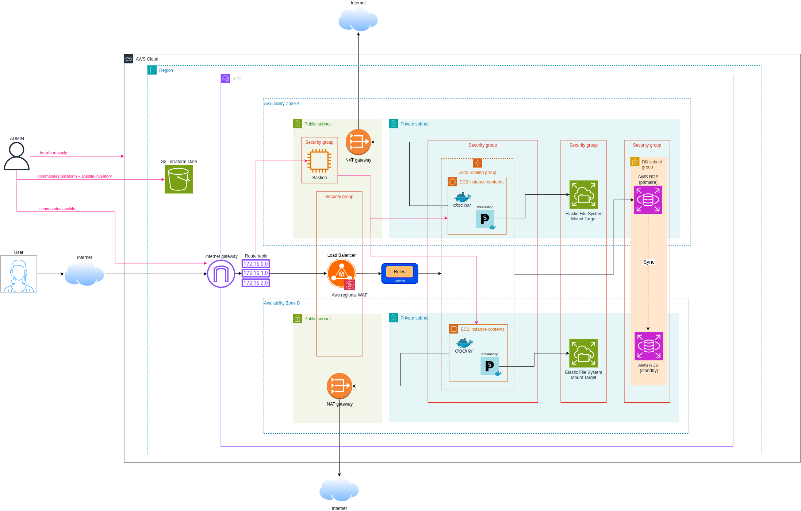

<a id="readme-top"></a>

<h2 align="center">5HASH</h2>
<h3 align="center">Déploiement de Prestashop à l'aide d'outils d'automatisation </h3>
</br>

<!-- TABLE OF CONTENTS -->
<details open>
    <summary>Sommaire</summary>
    <ol>
        <li>
            <a href="#à-propos-du-projet">À propos du projet</a>
        </li>
        <li>
            <a href="#architecture">Architecture</a>
        </li>
        <li>
            <a href="#prérequis">Prérequis</a>
        </li>
        <li>
            <a href="#mise-en-place">Mise en place</a>
        </li>
        <li><a href="#environnement">Environnement</a></li>
        <li><a href="#procédures-de-tests-et-vérifications">Procédures de tests et vérifications</a></li>
    </ol>
</details>

<!-- ABOUT THE PROJECT -->

## À propos du projet

Dans le cadre du concert de Taylor Shift, il nous a été demandé de configurer l'infrastructure et le déploiement d'une plateforme e-commerce de vente de billets de concert basée sur l'image Prestashop. L'infrastructure doit pouvoir supporter des pics de trafic, notamment à l'ouverture de la billetterie.

L'objectif est d'automatiser le déploiement en utilisant Terraform et Ansible pour éviter l'intervention d'une maintenance manuelle.

## Architecture

**Figure: Architecture de l'infrasture de Prestashop.** Les flèches roses réprésentent les intéractions de l'admin : les commandes terraform mettent à jour l'état de Terraform qui est ensuite stocké dans le bucket S3, et les commandes ansibles permettent de configurer les instances. Les flèches noires sont associées aux parcours d'une requête utilisateur.


L'infrastructure est déployée dans la région `eu-west-3`, au sein d'un VPC réparti sur deux zones de disponibilité :

- **Load Balancer + WAF** : point d'entrée unique des utilisateurs, placé dans les sous-réseaux publics. Le WAF filtre les requêtes malveillantes avant de les transmettre aux instances.
- **Auto Scaling group** : 2 à 3 instances EC2 réparties dans les sous-réseaux privés des deux AZ, qui exécutent PrestaShop dans un conteneur Docker. Une instance défaillante est détectée par le health check du Load Balancer et remplacée automatiquement.
- **EFS** : système de fichiers partagé, monté sur chaque instance, pour que toutes servent les mêmes fichiers PrestaShop (images, modules…).
- **RDS MySQL multi-AZ** : base de données managée, avec une instance de secours synchronisée dans l'autre AZ. Le mot de passe est stocké dans Secrets Manager.
- **Bastion** : seul point d'accès SSH, utilisé par Ansible pour configurer les instances privées.
- **NAT gateways** : une par AZ, pour que les instances privées accèdent à Internet (images Docker, paquets) sans être exposées.
- **Bucket S3** : stocke le state Terraform, avec verrouillage et chiffrement.

## Prérequis

- Docker
- un compte aws avec un minimum de crédit disponible
- Avoir aws CLI installé
- utiliser la région eu-west-3

## Mise en place

1. **Dans un terminal, exporter ses propres variables d'environnement fournies par la console aws :**

```sh
export AWS_ACCESS_KEY_ID="..."
export AWS_SECRET_ACCESS_KEY="..."
```

2. **Construire l'image docker depuis la racine :**

```sh
docker build -t 5hash-tools .
```

3. **Créer le bucket s3 au préalable avec la commande :**

> /!\ **Important :**
> Les noms de bucket sont uniques, il vous faudra remplacer "5hash-bucket" par votre nom de bucket dans la commande ci-dessous ainsi que dans le fichier `/terraform/backend.tf`

```sh
aws s3api create-bucket --bucket "5hash-bucket" --region eu-west-3 --create-bucket-configuration LocationConstraint=eu-west-3
```

4. **Générer une clé ssh à la racine du projet**

```sh
mkdir -p .keys
ssh-keygen -t ed25519 -f .keys/key-5hash -N ""
```

5. **Création du mot de passe de la base de données côté terraform**

```sh
read -rsp "db secret: " TF_VAR_db_pwd
export TF_VAR_db_pwd
echo
```

6. **Création du vault dans docker pour ansible :**

```sh
./run.sh ansible-vault create ansible/group_vars/all/vault.yml
```

Dans le vault, entrer les valeurs suivantes :

```
db_pwd: "xxxx"
db_user: "admin"
db_name: "mydb"
```

> /!\ Attention : les valeurs du Vault doivent correspondre à celles de terraform.
> db_pwd doit être identique à la valeur de TF_VAR_db_pwd

7. **Initialisation, planification, et création des ressources Terraform**

```sh
./run.sh terraform -chdir=terraform init
./run.sh terraform -chdir=terraform fmt -recursive
./run.sh terraform -chdir=terraform validate
./run.sh terraform -chdir=terraform plan
./run.sh terraform -chdir=terraform apply
```

8. **Lancer les commandes Ansible pour configurer les EC2 dans l'ordre suivant :**

```sh
./run.sh ansible-galaxy install -r ansible/requirements.yml
./run.sh ansible-inventory -i ansible/inventory/prestashop.terraform.yml --graph
./run.sh ansible-inventory -i ansible/inventory/prestashop.terraform.yml --list
./run.sh ansible-playbook -i ansible/inventory/prestashop.terraform.yml ansible/site.yml --ask-vault-pass
./run.sh ansible-playbook -i ansible/inventory/prestashop.terraform.yml ansible/site.yml --ask-vault-pass
```

> Note : La première installation de prestashop prend entre 30 à 40 minutes, donc l'execution du test de [Déploiement de prestashop](#procédures-de-tests-et-vérifications) (point 5 ci dessous) doit se faire après ce délai, quand, dans le point 4, les premiers log d'apache apparraissent.

## Environnement

L'inventaire dynamique Ansible repose sur le plugin cloud.terraform.terraform_provider. Il lit le state Terraform et construit l'inventaire à partir des ressources ansible_host qui y sont déclarées. La dernière version de ce plugin (collection cloud.terraform 4.0.0) est incompatible avec ansible-core 2.21 et suivantes : elle utilise une fonction d'Ansible dont un paramètre a été supprimé, et aucune version corrective n'est publiée à ce jour.

Le contournement de ce bug ne faisant pas l'objet du projet, les fichiers `Dockerfile`, `.dockerignore` et `run.sh` ont été générés afin de figer les outils sur des versions antérieures au bug :

| Outil        | Version |
| ------------ | ------- |
| Terraform    | 1.16.3  |
| ansible-core | 2.18.19 |

Seule la version d'ansible-core est figée pour contourner le bug. Celle de Terraform l'est pour que tous les utilisateurs travaillent avec exactement le même outil.

L'image Docker `5hash-tools` fournit ainsi un environnement identique et fonctionnel, quel que soit l'OS de la machine.

> **Utilisation du préfixe `./run.sh`**
>
> Le script `run.sh` exécute le conteneur `5hash-tools`, en y montant le projet et en transmettant les variables d'environnement nécessaires (identifiants AWS, `TF_VAR_db_pwd`).
>
> - **Commandes `terraform` et `ansible-*`** : à préfixer par `./run.sh` pour qu'elles tournent avec les versions figées.
> - **Autres commandes** (`docker`, `aws`, `ssh-keygen`, `ssh`, `curl`) : à exécuter directement sur la machine, sans préfixe.

## Procédures de tests et vérifications

Les `<DNS-DU-LOAD-BALANCER>` et `<IP-DU-BASTION>` sont disponibles avec la commande :

```sh
./run.sh terraform -chdir=terraform output
```

1. Vérification du fonctionnement du firewall :

```sh
curl -i "http://<DNS-DU-LOAD-BALANCER>/?q=<script>alert(1)</script>"
```

> Résultat attendu : un statuscode 403 FORBIDDEN.

2. Vérification de la mise en place du RDS multi AZ :

```sh
aws rds describe-db-instances --region eu-west-3 --query "DBInstances[?DBName=='mydb'].[MultiAZ,AvailabilityZone,SecondaryAvailabilityZone]" --output table
```

> Résultat attendu : un tableau avec la valeur true et le nom des différentes AZ.

3. Test de la connexion en ssh sur le bastion :

```sh
ssh -i .keys/key-5hash admin@<IP-DU-BASTION>
```

> Résultat attendu : vous êtes connecté au bastion

4. Vérification du lancement du conteneur Prestashop

```sh
./run.sh ansible web-0 -i ansible/inventory/prestashop.terraform.yml -b -m ansible.builtin.command -a "docker logs --tail 40 prestashop"
```

> Résultat attendu : le log du container ciblé (web-0 ou web-1) s'affiche.

5. Déploiement de prestashop

```sh
curl -I http://<DNS-DU-LOAD-BALANCER>
```

> Résultat attendu : un statuscode 200 OK.

## Explication et justification des choix techniques

### Structure des dossiers du projet

À la racine du projet, on retrouve le README, le run.sh et le Dockerfile ainsi que les fichiers .gitignore et .dockerignore. La documentation restante se trouve dans le dossier `Docs` (sujet et image de l'architecture complète et détaillée).

Concernant la partie technique, nous avons souhaité séparer la partie infrastructure de la partie configuration. C'est pourquoi nous retrouvons un dossier `terraform` et un dossier `ansible`.

**Terraform**

Dans notre organisation, les groupes de ressources ayant la même fonction ont été rassemblés au sein d'un même module, on en compte 7 (ansible, database, compute ...). Les modules communiquent entre eux grâce au fichier main.tf situé à la racine.

backend.tf contient la configuration du stockage du state de terraform dans un bucket s3 chiffré et en remote. Pour éviter un accès concurrent, nous avons activé le paramètre use_lockfile.

Dans version.tf, il y a la déclaration des dépendances de terraform tandis que dans provider.tf on configure le fournisseur cloud choisi, AWS dans notre cas.

Les données que nous souhaitons exposer se retrouvent dans outputs.tf. Les variables globales que nous souhaitons propager sont dans variables.tf.

**Ansible**

À la racine de ce dossier, on retrouve le fichier de configuration ansible.cfg, le playbook principal : "site.yml" qui comprend 2 rôles. Le premier, geerlingguy.docker, permet d'installer docker et ses dépendances. Le second, prestashop, va installer et configurer tout le nécessaire pour le fonctionnement de l'image prestashop dans un container docker sur chaque instance.

Le fichier requirements.yml contient le rôle geerlingguy.docker ainsi que les collections qui vont nous donner accès aux modules utilisés pour appliquer les différentes tâches.

Le dossier `inventory` contient le fichier contenant le plugin terraform_provider qui fournit dynamiquement les hôtes sur lesquels ansible va exécuter ses tâches.

### Limites

La limite la plus contraignante vient du fait que les commandes terraform apply et ansible-playbook sont exécutées manuellement. Lors d'un upscale, l'Auto Scaling group lance une nouvelle instance EC2. L'inventaire Ansible, lui, n'est construit qu'au moment du terraform apply : la nouvelle instance n'y figure pas tant que terraform apply n'a pas été relancé. Elle démarre donc sans Docker, sans le montage de l'EFS et sans le conteneur PrestaShop, tant que ansible-playbook n'a pas été relancé à son tour. En attendant, le load balancer la juge unhealthy et ne lui envoie aucun trafic. Si personne n'intervient, l'Auto Scaling group la remplace à la fin de la grace period (3600 s), par une instance tout aussi vide.

Pour pallier ce problème, il faudrait que les instances se configurent seules au démarrage, par exemple avec un user_data dans le launch template qui exécute Ansible localement, ou avec une AMI préparée à l'avance. Le plugin amazon.aws.aws_ec2, utilisé à la place de terraform_provider, garderait l'inventaire à jour sans terraform apply, mais il faudrait toujours relancer le playbook pour configurer la nouvelle instance.

Dans le cas où une instance viendrait à tomber, le load balancer la détecte comme unhealthy après environ 90 secondes (3 health checks échoués consécutifs, espacés de 30 secondes) et cesse de lui envoyer du trafic : les visiteurs sont servis par l'autre instance. L'Auto Scaling group la remplace ensuite par une nouvelle instance. Grâce à l'EFS, les fichiers de PrestaShop sont déjà présents, mais cette nouvelle instance doit tout de même être configurée par Ansible (Docker, montage de l'EFS, conteneur) après un terraform apply.

Malgré l'auto-scaling des instances, nous n'avons qu'une seule base de données en écriture : l'instance de secours du Multi-AZ assure la disponibilité en cas de panne, mais ne répond à aucune requête. Si cette base sature, le service est ralenti, puisqu'elle ne se met pas à l'échelle automatiquement. Les évolutions possibles sont d'augmenter la taille de l'instance RDS ou d'ajouter des réplicas en lecture.

Temps d'attente de la première installation extrêmement long (30 à 40 min).

La période de grâce d'une heure nécessaire à une première installation implique qu'une nouvelle instance créée qui a un status unhealthy ne sera remplacée qu'après une heure.

La connexion en SSH au bastion ne fonctionne que depuis l'IP de la machine qui a lancé le terraform apply.

Pour séparer la configuration des instances de celle du conteneur, nous avons fait un template contenant les variables d'environnement de ce dernier : le template permet de générer un fichier d'environnement stocké sur l'instance à partir du vault et utilisé directement par le container. Cela introduit une étape intermédiaire entre la lecture des secrets du vault et l'utilisation de ces variables par le conteneur, ce qui induit un stockage des mots de passe en clair sur l'instance uniquement protégés par les droits d'accès ROOT (0600).
