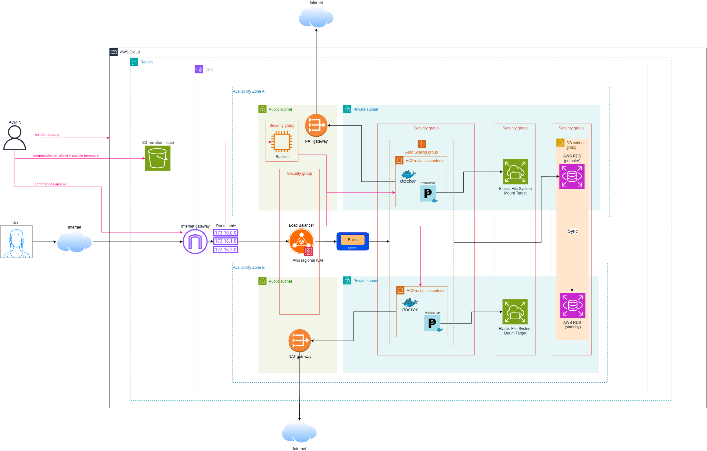

<a id="readme-top"></a>

<h2 align="center">5HASH</h2>
<h3 align="center">Déploiement de Prestashop à l'aide d'outils d'automatisation </h3>
</br>

<!-- TABLE OF CONTENTS -->
<details open>
    <summary>Sommaire</summary>
    <ol>
        <li>
            <a href="#à-propos-du-projet">À propos du projet</a>
        </li>
        <li>
            <a href="#architecture">Architecture</a>
        </li>
        <li>
            <a href="#prérequis">Prérequis</a>
        </li>
        <li>
            <a href="#mise-en-place">Mise en place</a>
        </li>
        <li><a href="#environnement">Environnement</a></li>
        <li><a href="#procédures-de-tests-et-vérifications">Procédures de tests et vérifications</a></li>
    </ol>
</details>

<!-- ABOUT THE PROJECT -->
## À propos du projet
Dans le cadre du concert de Taylor Shift, il nous a été demandé de configurer l'infrastructure et le déploiement d'une plateforme e-commerce de vente de billets de concert basée sur l'image Prestashop. L'infrastructure doit pouvoir supporter des pics de trafic, notamment à l'ouverture de la billetterie. 

L'objectif est d'automatiser le déploiement en utilisant Terraform et Ansible pour éviter l'intervention d'une maintenance manuelle.


## Architecture



L'infrastructure est déployée dans la région `eu-west-3`, au sein d'un VPC réparti sur deux zones de disponibilité :

- **Load Balancer + WAF** : point d'entrée unique des utilisateurs, placé dans les sous-réseaux publics. Le WAF filtre les requêtes malveillantes avant de les transmettre aux instances.
- **Auto Scaling group** : 2 à 3 instances EC2 réparties dans les sous-réseaux privés des deux AZ, qui exécutent PrestaShop dans un conteneur Docker. Une instance défaillante est détectée par le health check du Load Balancer et remplacée automatiquement.
- **EFS** : système de fichiers partagé, monté sur chaque instance, pour que toutes servent les mêmes fichiers PrestaShop (images, modules…).
- **RDS MySQL multi-AZ** : base de données managée, avec une instance de secours synchronisée dans l'autre AZ. Le mot de passe est stocké dans Secrets Manager.
- **Bastion** : seul point d'accès SSH, utilisé par Ansible pour configurer les instances privées.
- **NAT gateways** : une par AZ, pour que les instances privées accèdent à Internet (images Docker, paquets) sans être exposées.
- **Bucket S3** : stocke le state Terraform, avec verrouillage.

## Prérequis

- Docker
- un compte aws avec un minimum de 5$ de crédit
- Avoir aws CLI installé
- utiliser la région eu-west-3

## Mise en place

1. **Dans un terminal, exporter ses propres variables d'environnement fournies par la console aws :** 

```sh
export AWS_ACCESS_KEY_ID="..."
export AWS_SECRET_ACCESS_KEY="..."
```

2. **Construire l'image docker depuis la racine:**

```sh
docker build -t 5hash-tools .
```

Si cette commande renvoie "Permission denied", exécuter la commande : `chmod +x run.sh` et relancer le build.

3. **Créer le bucket s3 au préalable avec la commande :**

> /!\ **Important :**
> Les noms de bucket sont uniques, il vous faudra remplacer "5hash-bucket" par votre nom de bucket dans la commande ci-dessous ainsi que dans le fichier `/terraform/backend.tf`

```sh
aws s3api create-bucket --bucket "5hash-bucket" --region eu-west-3 --create-bucket-configuration LocationConstraint=eu-west-3
```

4. **Générer une clé ssh à la racine du projet**
```sh
mkdir -p .keys
ssh-keygen -t ed25519 -f .keys/key-5hash -N ""
```

5. **Création du mot de passe de la base de données côté terraform**
```sh
read -rsp "db secret: " TF_VAR_db_pwd
export TF_VAR_db_pwd
echo
```

6. **Création du vault dans docker pour ansible:**
```sh
./run.sh ansible-vault create ansible/group_vars/all/vault.yml
```
Dans le vault, entrer les valeurs suivantes : 
```
db_pwd: "xxxx"
db_user: "xxx"
db_name: "xxx"
```
> /!\ Attention : les valeurs du Vault doivent correspondre à celles de terraform. 

7. **Initialisation, planification, et création des ressources Terraform**
```sh
./run.sh terraform -chdir=terraform init
./run.sh terraform -chdir=terraform fmt -recursive
./run.sh terraform -chdir=terraform validate
./run.sh terraform -chdir=terraform plan
./run.sh terraform -chdir=terraform apply
```

8. **Lancer les commandes Ansible pour configurer les EC2 dans l'ordre suivant :**  
```sh
./run.sh ansible-galaxy install -r ansible/requirements.yml
./run.sh ansible-inventory -i ansible/inventory/prestashop.terraform.yml --graph
./run.sh ansible-inventory -i ansible/inventory/prestashop.terraform.yml --list
./run.sh ansible-playbook -i ansible/inventory/prestashop.terraform.yml ansible/site.yml --ask-vault-pass
./run.sh ansible-playbook -i ansible/inventory/prestashop.terraform.yml ansible/site.yml --ask-vault-pass
```

---
>**En cas de terraform destroy il faut delete le secret**
>```sh
>aws secretsmanager delete-secret --secret-id "5HASH/db-pwd" --region eu-west-3 --force-delete-without-recovery
>```

## Environnement
L'inventaire dynamique Ansible repose sur le plugin `cloud.terraform.terraform_provider`, qui lit directement le state Terraform pour lister les instances. Ce plugin présente un bug avec les versions récentes de Terraform et d'Ansible.

Le contournement de ce bug ne faisant pas l'objet du projet, les fichiers `Dockerfile`, `.dockerignore` et `run.sh` ont été générés afin de figer les outils sur des versions antérieures au bug :

| Outil | Version |
|---|---|
| Terraform | 1.16.3 |
| ansible-core | 2.18.19 |

L'image Docker `5hash-tools` fournit ainsi un environnement identique et fonctionnel, quel que soit l'OS de la machine.

>**Utilisation du préfixe `./run.sh`**
>
>Le script `run.sh` exécute le conteneur `5hash-tools`, en y montant le projet et en transmettant les variables d'environnement nécessaires (identifiants AWS, `TF_VAR_db_pwd`).
>- **Commandes `terraform` et `ansible-*`** : à préfixer par `./run.sh` pour qu'elles tournent avec les versions figées.
>- **Autres commandes** (`docker`, `aws`, `ssh-keygen`, `ssh`, `curl`) : à exécuter directement sur la machine, sans préfixe.


## Procédures de tests et vérifications
1. Vérification du fonctionnement du firewall : 

```sh
curl -i "http://<DNS-DU-LOAD-BALANCER>/?q=<script>alert(1)</script>"
```

2. Vérification de la mise en place du RDS multi AZ :
```sh
aws rds describe-db-instances --db-instance-identifier terraform-bdc3b32b5ca88f0b0bcde1005f --region eu-west-3 --query 'DBInstances[0].[MultiAZ,AvailabilityZone,SecondaryAvailabilityZone]'
```

3. Test de la connexion en ssh sur le bastion :
```sh
ssh -i .keys/key-5hash admin@<IP-DU-BASTION>
```

4. Vérification du lancement du conteneur Prestashop

```sh
./run.sh ansible web-0 -i ansible/inventory/prestashop.terraform.yml -b -m ansible.builtin.command -a "docker logs --tail 40 prestashop"
```

5. Déploiement de prestashop
```sh
curl -I http://<DNS-DU-LOAD-BALANCER>
```
